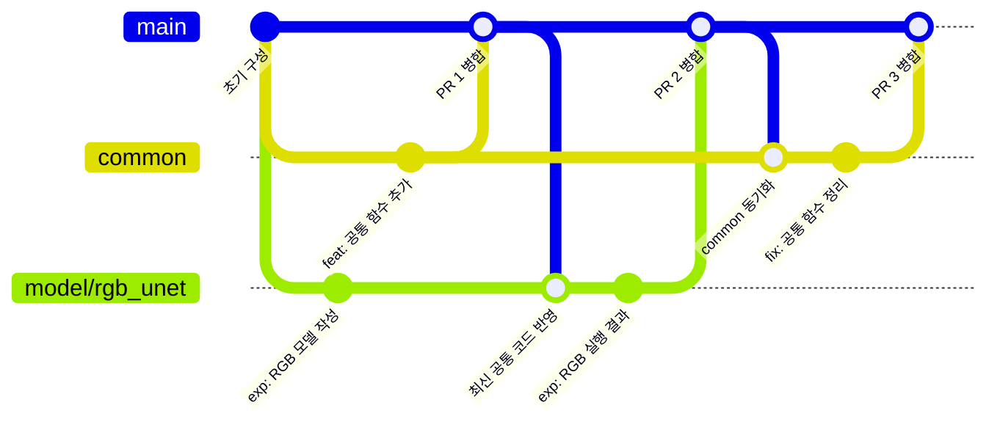

# 프로젝트 기여 규칙

## 작업 전 확인

[README.md](README.md), 이 문서, [TODO.md](TODO.md)를 순서대로 읽는다. 담당 작업과 진행 상태를 확인하고, 실행 환경·공통 평가 조건이 미정이면 기본 비교 학습을 시작하기 전에 확정한다.

최초 참여와 새 실행은 [노트북 실행과 결과 전달](docs/workflow.md)을 따른다. 과거 노트북·보고서의 설정은 해당 실행 기록이며, 팀 규약으로 별도 확정하지 않은 값을 새 실험의 필수값으로 취급하지 않는다.

## 작업 브랜치

Git 운영 시작 후에는 아래 담당 브랜치에서 작업한다. 모델 작업을 다른 모델의 브랜치나 통합 대상 브랜치에서 직접 진행하지 않는다.

| 작업 영역 | 브랜치 |
| --- | --- |
| RGB U-Net | `model/rgb_unet` |
| ELA U-Net | `model/ela_unet` |
| RGB+ELA U-Net | `model/rgb_ela_unet` |
| CAT-Net | `model/catnet` |
| EDA | `eda` |
| 공통 스크립트·환경·운영 문서 | `common` |

통합 브랜치는 `main`으로 사용한다. 작업 브랜치는 초기 구성 시 `main`에서 만들고, PR 병합 후에도 삭제하지 않고 계속 사용한다. 팀이 공유할 코드는 작업 브랜치에서 검토를 거쳐 `main`에 반영한다.

- `main`에 직접 push하지 않는다. 작업 브랜치에서 `main`으로 PR을 만든다.
- 같은 브랜치는 한 번에 한 사람만 작업한다. 특히 `common`·`eda`는 작업 시작 전에 담당자와 순서를 공유한다.
- 같은 브랜치의 PR이 열려 있으면 검토에 필요한 수정만 추가하고, 병합을 마친 뒤 다음 작업을 시작한다.
- 다른 사람이 같은 노트북을 동시에 수정하지 않는다. 담당 파일과 개인 실험 번호를 TODO에서 확인한다.
- 모델 실험에 공통 코드 변경이 필요하면 `common` 작업으로 분리하고, 반영된 코드 버전을 모델 브랜치에 가져온다.
- 충돌이 나면 한쪽을 임의로 덮어쓰거나 강제 push하지 않고 병합 담당자와 함께 해결한다. 공유 브랜치의 이력을 rebase로 다시 쓰지 않는다.

### 반복하는 작업 순서

Git 운영을 시작한 뒤에는 다음 순서로 진행한다.

1. 수정 중인 파일을 정리한 뒤 담당 브랜치로 이동하고, 원격의 같은 브랜치 변경을 먼저 받는다.
2. 최신 원격 `main`을 담당 브랜치에 병합한다. 충돌이 있으면 해결한 뒤 작업을 시작한다.
3. 코드·노트북·문서를 수정하고 변경에 필요한 검증을 진행한다.
4. 변경 파일과 내용을 확인하고 아래 접두어 규칙으로 커밋한 뒤 담당 브랜치에 push한다.
5. 담당 브랜치 → `main`으로 PR을 만들고, 작성자 외 팀원 1명에게 검토를 요청한다.
6. 검토가 끝나면 지정한 병합 담당자가 `Create a merge commit`으로 병합한다. 브랜치는 유지한다.

Git의 commit·push·병합은 Drive에 공통 코드를 업로드하는 절차와 별개다. 다음 Colab 실행 전에 [Drive 업로드 절차](README.md#공통-코드-수정-후-drive-업로드--필수)를 따른다.

### 병합 흐름 한눈에 보기

아래는 `main`, `common`, `model/rgb_unet`의 브랜치 흐름 예시다. 다른 모델 브랜치와 `eda`도 같은 방식으로 운영한다. 실제 커밋 이력이 아니라 운영 방식을 설명하는 그림이다.



왼쪽에서 오른쪽으로 시간이 흐르며, 가로선은 브랜치, 점은 커밋, 선이 합쳐지는 부분은 병합을 뜻한다.

- `common → main`: 공통 함수 변경을 PR 검토 후 반영한다.
- `main → model/rgb_unet`: 통합된 공통 코드를 모델 브랜치로 가져온 뒤 해당 버전으로 실행한다.
- `model/rgb_unet → main`: 실험 결과와 보고서를 PR 검토 후 반영한다.
- `main → common`: 다음 공통 작업 전에 최신 통합 내용을 가져온다. 같은 `common` 브랜치에서 다음 작업과 PR을 이어간다.

`main`으로 들어가는 PR 1·2·3은 모두 작성자 외 팀원 1명의 승인 후 병합 담당자가 `Create a merge commit`으로 병합한다. 병합 후 작업 브랜치는 유지한다. `main`을 작업 브랜치로 가져오는 동기화는 PR 병합과 구분한다.

### 운영 시작 전 남은 준비

T04의 Git 운영 정책 문서화는 완료했다. 아래 항목은 정책 확정과 구분한 실제 운영 준비다.

최초 프로젝트 등록은 기존 로컬 `main`에 구조·공통 함수·데이터 연결·예제·EDA·진행 문서를 여섯 커밋으로 나눠 기록한다. 이 초기 등록 이후의 작업은 위 브랜치·PR 규칙을 따른다. 최초 push는 완료했으며, 팀원 접근 권한·작업 브랜치 구성·병합 담당자는 추가로 확인한다.

| 남은 항목 | 현재 상태 |
| --- | --- |
| 원격 저장소·접근 권한 | origin 연결 및 최초 push 완료. 팀원 접근 권한 확인 필요 |
| 원격 최초 업로드 | kimjaehak 완료 |
| 병합 담당자 | 한 명으로 운영하며 담당자는 미정 |
| 작업 브랜치 구성·팀원 clone 안내 | 추가 확인·작성 필요 |
| GitHub 보호 규칙·자동 검사 | 미구성. 현재 규칙은 팀이 직접 준수함 |

## 커밋 규칙

커밋 메시지는 소문자 접두어 뒤에 콜론과 공백을 넣고, 무엇을 바꿨는지 짧은 한국어 문장으로 작성한다.

```text
접두어: 변경 내용
```

| 접두어 | 사용 범위 | 예시 |
| --- | --- | --- |
| `exp` | 모델 실험·EDA 노트북 작성, 실행 결과와 관련 보고서 반영 | `exp: kimjaehak 003 ELA 검증 결과 추가` |
| `feat` | 공통 함수·기능 추가 | `feat: 공통 이미지 변환 함수 추가` |
| `docs` | 안내 문서 추가·수정, 문서만 바꾸는 작업 | `docs: Colab 실행 안내 추가` |
| `fix` | 기존 코드의 오류 수정·리팩토링·구조 정리 | `fix: 전처리 입력 검사 정리` |

리팩토링도 이 프로젝트에서는 `fix`를 사용한다. 별도 `refactor` 접두어를 추가하지 않는다. 커밋 접두어 `exp`와 실험 파일명의 `EXP_`는 서로 다른 규칙이다.

- 한 커밋은 한 가지 목적의 변경으로 묶는다. 작업 중간에도 커밋할 수 있으며 PR 하나에 여러 커밋이 있어도 된다.
- 실험 결과와 그 보고서·결과 목록·TODO를 함께 반영하면 `exp`를 사용한다. 안내 문서만 바꾸면 `docs`를 사용한다.
- 공통 함수 추가와 그 사용 설명은 같은 목적이면 `feat`로 함께 묶을 수 있다. 관련 없는 변경은 나눠 커밋한다.
- `수정`, `최종`처럼 변경 내용을 알 수 없는 메시지는 피한다.
- 커밋 전에 포함할 파일을 확인한다. 데이터 ZIP·가중치·인증 파일은 제외하고, 실험 노트북은 저장된 출력을 포함한다.
- Git이 만드는 병합 커밋 메시지는 직접 작성하는 작업 커밋의 접두어 규칙에서 제외한다.

## 실험 이름과 개인 번호

```text
EXP_Git이름_개인실험번호_실험내용.확장자
```

- Git 이름은 팀에서 정한 작성자 식별자를 일관되게 사용한다. 김재학의 식별자는 `kimjaehak`이다.
- 식별자를 `git config user.name`에서 자동 추측하거나 변환하지 않는다.
- 각자 `001`부터 자기 번호를 관리하고, 모델·EDA 폴더가 바뀌어도 번호를 이어간다.
- 다른 작성자는 같은 번호를 사용해도 된다. 번호는 팀 전체의 실행 순서가 아니다.
- 동일 작성자의 번호는 재사용하지 않는다. 세 자리 이상으로 표기한다(`001`, …, `999`, `1000`).
- 실험 내용은 공백 없이 영문 소문자·숫자·밑줄로 간단하게 작성한다.
- 실험을 연결할 때는 번호만 쓰지 않고 모델 폴더와 파일명 전체를 사용한다.

노트북과 보고서는 확장자를 제외한 파일명이 같아야 한다.

```text
notebooks/rgb_unet/EXP_kimjaehak_001_rgb_unet_baseline.ipynb
docs/rgb_unet/EXP_kimjaehak_001_rgb_unet_baseline.md
```

위 파일은 이름 예시이며, 실행된 실험을 의미하지 않는다. 새 번호는 `notebooks/`와 `docs/`의 모든 모델·EDA 폴더에서 자기 ID의 사용 번호를 확인한 뒤 정한다. 이미 사용한 번호와 충돌하면 다음 번호를 사용한다. 다른 팀원이 처음 참여할 때는 자기 ID의 001부터 시작한다.

## 노트북 작성과 확정

팀의 노트북 실행·결과 전달은 다음 절차를 필수로 따름.

1. 기본 실행은 로컬 프로젝트의 `.ipynb`를 VS Code에서 열고 Google Colab 확장의 원격 커널을 선택함. 로컬 실행용으로 작성할 때는 [데이터 배치 안내](data/README.md)를 따르고 새 개인 번호의 노트북에 실제 실행 환경을 명시함. 기존 Colab 확정본은 수정하지 않음.
2. 공통 코드를 수정·추가한 사람은 다음 Colab 실행 전에 반드시 공유 Drive의 `AI_Forensics/project/scripts/`에도 같은 상대 경로로 업로드하여 기존 파일을 교체함. 로컬 저장만으로는 반영되지 않음. 공통 스크립트와 분할 CSV가 로컬과 일치하는지 확인하고 [업로드 절차](README.md#공통-코드-수정-후-drive-업로드--필수)를 따름.
3. 작성 중인 노트북을 최종 검증할 때는 커널을 재시작하고 기존 출력을 지운 뒤 위에서부터 순서대로 실행함. 이전 실행 출력이 새 결과와 섞이지 않도록 함.
4. 환경·설정·코드 버전·표·그림·오류를 필요한 셀 출력에 남기고, 출력을 지우지 않은 채 `.ipynb`를 저장함. 다시 열어 출력이 저장됐는지 확인함. 실패·중단 시에도 실제 상태와 오류 출력을 보존함.
5. 저장한 파일을 프로젝트의 해당 `notebooks/` 경로에서 공유함. 다른 위치에서 실행했다면 결과 파일을 프로젝트로 가져오되, 확정된 노트북을 덮어쓰지 않음.
6. 저장된 출력과 설정을 기준으로 같은 이름의 보고서, `docs/results.md`, TODO를 갱신함. 보고서의 근거가 되는 결과는 노트북 출력에 남아 있어야 함.
7. 숫자·링크·실행 상태를 검토한 뒤 노트북을 확정함. 이후 재실행은 새 개인 번호로 진행함.

노트북 저장에는 커널의 모든 변수·가중치·런타임 파일이 포함되지 않음. 보고서에 필요한 값과 그림은 셀 출력으로 남겨야 함. 팀원이 실제 실행·저장한 출력을 검토하며, 로컬 실행 결과를 Colab 결과로 기록하지 않음. 자동 실행 연동은 후속 과제로 둠. 이 절차는 문서상의 필수 규칙이며 자동 차단 기능은 구성하지 않음.

노트북은 팀원이 위에서부터 실행하며 이해할 수 있도록 다음 흐름으로 작성한다.

1. 목적·가설·기준 실험과 변경 사항.
2. 환경 확인, 코드 버전, 시드·데이터 분할·입력·전처리 설정.
3. 이미지와 정답 마스크의 예시 확인.
4. 모델 구조, 손실 함수·최적화 설정.
5. 학습·검증 반복문과 체크포인트 선택 기준.
6. 공통 평가 함수 호출과 평가 조건·출력.
7. 예측 시각화, 성공·실패 사례, 보고서 링크.

모델과 학습 코드는 노트북에 두고, 공통 전처리·평가는 `scripts/`를 사용한다. CAT-Net 공식 모델의 준비·로드·추론은 `scripts/catnet.py`를 사용하며, Drive 마운트·경로·패키지 설치·평가·시각화는 노트북에 남긴다. 함수 설정값을 기록하며, 미정인 값을 임의로 팀 공통 기본값으로 정하지 않는다.

노트북의 상태는 `작성 중`, `실행 중`, `완료`, `실패`, `중단` 중 하나로 첫 Markdown 셀에 표시한다. **실행을 끝내고 출력까지 확인해 확정한 노트북은 수정하지 않는다.** 다른 조건이나 다시 실행한 결과를 남기려면 새 개인 번호로 복사해 시작하고 기준 실험을 연결한다. 초안 점검 중에는 수정할 수 있다. 실패·중단된 실행도 결과를 확인해 확정했다면 같은 보존 규칙을 따른다.

노트북에는 실제 실행한 공통 코드·분할 파일의 SHA-256과 최종 설정을 남긴다. Git 운영 시작 후에는 코드 기준 커밋도 함께 기록한다. 커밋되지 않은 변경이 있으면 변경 내용·해시를 기록하며 커밋만으로 재현 가능하다고 표시하지 않는다. 초기 실험처럼 실행 당시 커밋이 없었다면 파일 해시로 실행 버전을 구분한다. 나중에 만든 커밋을 과거 실행 당시의 커밋으로 소급 기록하지 않는다. 공통 코드가 바뀌었다고 이전 노트북을 일괄 수정하거나 다시 실행하지 않는다.

확정 후 새 실행 없이 사람의 시각 검토·해석을 추가할 때는 보고서에 날짜·검토자·근거를 기록한다. 이 절차로 완료된 002의 남은 사람 검토를 기록할 수 있다. 새 코드 실행이나 새로운 출력이 필요하면 새 개인 번호를 사용한다.

세 U-Net의 기본 비교에서는 입력 구성 외의 조건을 맞춘다. 기본 비교 후 개선 실험은 새 번호로 구분한다. CAT-Net은 고유 전처리·가중치·학습 조건을 별도 기록한다.

## 보고서 작성

노트북과 같은 모델 폴더에 같은 이름의 Markdown 보고서를 직접 작성한다. `make_reports.py`와 자동 보고서 생성 절차는 두지 않는다. 다음 항목을 포함한다.

| 항목 | 기록할 내용 |
| --- | --- |
| 기본 정보 | 실험 이름, 작성자, 실행일, 상태, 노트북 링크 |
| 목적·가설 | 확인할 질문, 기준 실험 보고서 링크, 바꾼 조건 |
| 데이터 | 데이터셋·버전, 분할 식별자, 표본 수, 정상 이미지 포함 여부 |
| 모델·학습 | 모델 구조, 입력, 손실, 최적화, 시드, 학습 예산, 체크포인트 기준 |
| 전처리·평가 | ELA 설정·처리 순서, 임계값, 해상도, 압축 조건·후처리·집계 규약 |
| 재현 정보 | Python·패키지 버전, GPU, 코드 버전과 미커밋 변경 여부 |
| 결과 | 실제 측정 점수, 해당 노트북 셀의 제목 또는 출력 위치 |
| 분석 | 정성평가, 성공·실패 사례, 모델 구조와 결과에 대한 해석 |
| 결론 | 가설에 대한 판단, 한계, 후속 실험 |

보고서는 기존 결과를 유지하면서 날짜를 붙여 해석을 추가할 수 있다. 숫자를 정정한다면 근거와 날짜를 남긴다. 노트북 실행 결과 자체의 수정이 필요하면 새 실험으로 진행한다.

## 통합 점수표와 링크

- `docs/results.md`에 데이터셋·분할·평가 조건과 함께 결과를 추가한다.
- 개별 보고서와 노트북은 서로 상대 경로로 연결한다.
- 통합 점수표의 실험 이름은 보고서로 연결하고 노트북 링크도 제공한다.
- 기준 실험이 있다면 보고서에서 그 실험의 보고서로 연결한다.
- 실제 출력에서 확인한 숫자만 쓴다. 미실행·실패·미측정·해당 없음을 구분하고, 빈 값을 `0`으로 채우지 않는다.
- 반올림 표기 자릿수를 맞추고, 노트북·보고서·점수표의 수치가 일치하는지 확인한다.
- 데이터·평가 조건이 다르면 같은 조건의 결과처럼 순위를 매기지 않는다.
- EDA는 F1·IoU 대상이 아니므로 점수를 만들지 않고 분석 목록에 연결한다.

## 실험 완료와 PR

- [ ] 파일명·개인 번호를 확인했다. Git 운영 시작 후에는 담당 브랜치도 확인했다.
- [ ] 필수 환경과 데이터·평가 조건을 확인했다.
- [ ] 최종 설정·코드 버전과 실행 출력이 노트북에 남아 있다.
- [ ] 변경한 공통 코드를 공유 Drive에 업로드했고, 커널을 재시작해 반영한 코드로 실행했다.
- [ ] Colab 또는 로컬 중 실제 실행 환경을 기록했고, 저장한 `.ipynb`를 다시 열어 출력을 확인했다.
- [ ] 같은 이름의 보고서를 작성했다.
- [ ] 통합 점수표 또는 EDA 목록에 조건·상태·링크를 추가했다.
- [ ] 실제 점수와 링크가 일치한다.
- [ ] TODO의 진행 상태와 후속 작업을 갱신했다.
- [ ] 확정 노트북을 보존하고 데이터·가중치·비밀키가 변경 목록에 없는지 확인했다.

위 체크리스트는 실험 결과를 반영할 때 적용한다. 문서만 수정한 PR은 문구·링크를, 공통 코드 PR은 관련 함수의 동작을 확인하며 해당 없는 모델 실행을 요구하지 않는다.

### PR 작성과 병합

PR은 실험 하나 또는 설명 가능한 변경 하나로 작성한다. 제목에는 변경 내용을 짧게 적고, 본문은 다음 세 항목만 작성한다.

```markdown
- 변경 내용: 무엇을 추가하거나 수정했는지
- 확인 결과: 실행·검증한 내용과 관련 노트북·보고서 링크
- 남은 사항: 미실행·실패·추가 검토 항목. 없으면 없음
```

- 대상 브랜치는 `main`으로 한다. 작성자 외 팀원 1명이 확인하고 승인한다.
- 실험 결과 PR에는 출력 포함 노트북·같은 이름의 보고서·결과 목록·TODO를 함께 반영한다. 실패한 실험도 실제 상태와 분석을 정리했다면 병합할 수 있다.
- 아직 검토를 요청할 준비가 되지 않았다면 Draft PR로 둔다. 검토 후 내용을 바꾸면 변경 부분을 다시 확인받는다.
- 지정한 병합 담당자가 승인과 남은 의견을 확인한 뒤 `Create a merge commit`으로 병합한다. Squash·Rebase 병합은 사용하지 않는다.
- 병합 담당자가 작성한 PR도 다른 팀원 1명의 승인을 받아야 한다.
- 병합 후 작업 브랜치를 삭제하지 않는다. 다음 작업자는 원격의 같은 브랜치와 최신 `main`을 반영한 뒤 시작한다.
