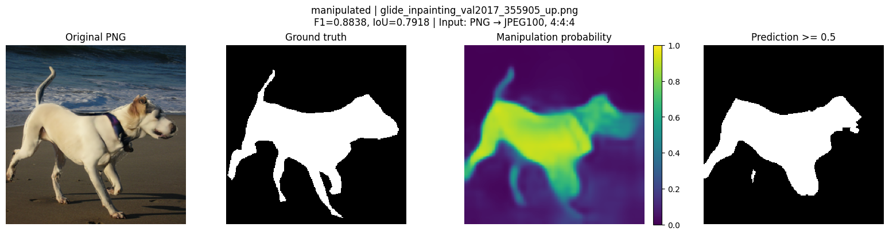
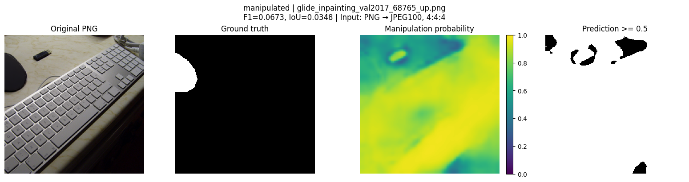
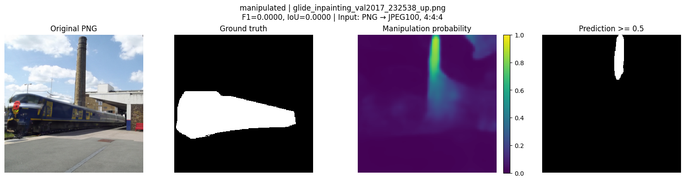
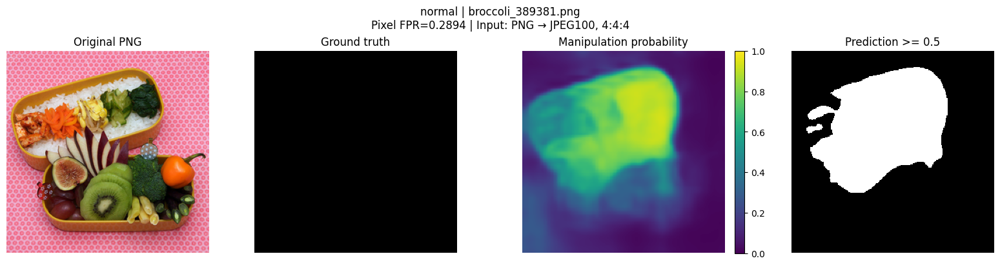

# CAT-Net 사전학습 모델의 전체 테스트 평가

| 항목 | 내용 |
| --- | --- |
| 작성자·실행자 | kimjaehak |
| 보고서 작성·출력 및 그림 검토일 | 2026-11-20 |
| 검토자 | Codex |
| 상태 | 완료 — 2,257장 집계와 저장된 그림 18개 확인. 재현 정보의 미확인 항목은 아래에 구분함 |
| 노트북 | [EXP_kimjaehak_004_catnet_pretrained_evaluation.ipynb](../../notebooks/catnet/EXP_kimjaehak_004_catnet_pretrained_evaluation.ipynb) |
| 기준 실험 | [003 단일 이미지 확인](EXP_kimjaehak_003_catnet_pretrained_check_singleImage.md) |
| 데이터 근거 | [002 EDA](../eda/EXP_kimjaehak_002_dataset_eda.md), [고정 분할](../../scripts/splits/README.md) |
| 관련 작업 | T12 진행 중. 사전학습 데이터 중복 검토·재현 정보 보완과 후속 분석이 남음 |

## 목적·가설·변경 사항

003에서 확인한 CAT_full_v2를 공통 함수로 로드하고 AutoSplice test와 CocoGlide 외부 테스트의 전체 점수를 확인함. 단일 이미지에서 확인한 동작이 전체 평가에서도 유지되는지, JPEG 품질과 데이터셋에 따라 성능이 달라지는지 확인하는 실험임. 학습·파인튜닝·임계값 탐색은 수행하지 않음.

003의 직접 호출을 `scripts/catnet.py`로 공통화했고, CocoGlide PNG의 JPEG 변환과 전체 평가 반복문·표본 시각화는 노트북에 작성함. GPU는 003의 L4에서 RTX PRO 6000 Blackwell Server Edition으로 달라짐. 두 실험의 속도를 비교하지 않음.

## 평가 조건

- AutoSplice는 `autosplice_seed42.csv`의 test만 선택함. 같은 조작 이미지의 JPEG 100·90·75를 각각 평가함. `Authentic` 정상 원본은 한 번만 포함하며 JPEG 품질별 정상 변형을 새로 만들지 않음.
- CocoGlide는 `table.csv`로 연결한 정상·조작 각 512장 전체를 외부 테스트로 사용함. 원본 PNG를 RGB로 변환한 뒤 JPEG 품질 100, `subsampling=0`(4:4:4)으로 별도 입력 파일을 만듦. 변환 수 1,024장과 원본 크기 유지 검사를 통과함. 원본 PNG와 정답 마스크는 보존함.
- 두 ZIP 모두 이번 저장 출력에서 `ZIP SHA-256 확인 및 압축 해제 완료`를 확인함. 이 출력만으로 런타임이 완전히 비어 있었다고 단정하지 않음.
- 공식 입력은 RGB 3채널+DCT volume 21채널, 첫 JPEG 성분의 양자화 테이블임. `crop_size=None`, `grid_crop=True`로 입력을 8배수 크기에 맞춤. 출력 logits를 입력 크기로 bilinear 보간(`align_corners=False`)한 뒤 softmax의 조작 클래스 1을 선택하고 원본 크기로 패딩을 제거함.
- 조작 확률 `>= 0.5`를 조작으로 판단함. 마스크는 전경 255를 1로 변환함. 정상 이미지는 원본 크기의 0 마스크를 사용함. 별도 평가 크롭·리사이즈·형태학적 후처리는 적용하지 않음.
- 조작 이미지마다 F1·IoU를 계산한 뒤 이미지별 산술평균을 구함. 정상 이미지는 픽셀 오탐률 `FP / (FP + TN)`을 계산한 뒤 이미지별 평균을 구함. 전체 픽셀을 합친 micro 집계가 아님.
- 조작 마스크가 비어 있으면 오류로 중단하도록 작성됨. 정상 이미지의 F1·IoU와 조작 이미지의 정상 오탐률은 계산하지 않음. 결과 표의 `NaN`은 이 경우의 해당 없음이며 실패나 0점이 아님.
- 위 조건은 004에서 사용한 평가 조건임. T06의 팀 공통 규약 전체를 승인한 것으로 간주하지 않음.

## 전체 평가 결과

저장된 최종 표의 여섯 집단을 합해 2,257장을 확인함. 조작 이미지 1,517장, 정상 이미지 740장임. 품질별 AutoSplice 조작본 335장은 서로 독립적인 원본 1,005개를 의미하지 않음.

| 데이터셋·분할 | 입력 조건 | 종류 | 이미지 수 | Pixel F1 | IoU | 정상 픽셀 오탐률 |
| --- | --- | --- | ---: | ---: | ---: | ---: |
| AutoSplice test | 기존 JPEG100 | 조작 | 335 | 0.881532 | 0.804299 | 해당 없음 |
| AutoSplice test | 기존 JPEG90 | 조작 | 335 | 0.804874 | 0.717161 | 해당 없음 |
| AutoSplice test | 기존 JPEG75 | 조작 | 335 | 0.402828 | 0.320014 | 해당 없음 |
| AutoSplice test | 정상 JPEG 원본 | 정상 | 228 | 해당 없음 | 해당 없음 | 0.146428 |
| CocoGlide external_test | PNG → JPEG100, 4:4:4 | 조작 | 512 | 0.363874 | 0.287961 | 해당 없음 |
| CocoGlide external_test | PNG → JPEG100, 4:4:4 | 정상 | 512 | 해당 없음 | 해당 없음 | 0.166143 |

수치는 저장된 HTML·텍스트 표의 소수점 여섯 자리를 그대로 기록함. 전체 이미지별 결과 DataFrame은 출력되지 않아 집계값을 이미지별 원자료에서 독립적으로 재계산하지 못함. 표본 시각화에 출력된 confusion counts는 별도로 재계산해 그림의 점수와 대조함.

## CocoGlide 정성 분석 — 2026-11-20

검토자: Codex. 22셀의 seed 42 조작 2·정상 2장, 24셀의 seed 43 추가 조작 5·정상 5장, 총 14개 그림을 확인함. 추가 표본은 앞서 본 경로를 제외하며 점수로 선정하지 않음. 각 그림은 시각화 시 다시 추론한 결과임. 전체 평가 당시 확률 배열은 저장되지 않아 두 추론의 배열 일치까지 검사한 것은 아님.

그림은 원본 PNG·정답·조작 확률·0.5 이진 예측 순서임. 모델이 읽은 것은 변환 JPEG이며, 왼쪽 패널에는 변환 전 PNG가 표시됨. 색상 범위는 모두 0~1로 고정됨.

### 조작 이미지: 미검출과 과검출이 함께 나타남

파일명은 모두 `glide_inpainting_val2017_<ID>_up.png`임. 아래 점수는 저장된 TP·FP·FN·TN에서 계산한 값이며 전체 512장의 분포를 대표한다고 단정하지 않음.

| ID | F1 | IoU | 그림·개수에서 확인한 현상 |
| --- | ---: | ---: | --- |
| 549167 | 0.437715 | 0.280176 | 음식 주변을 넓게 예측하나 정답의 분리된 영역 일부를 놓침. TP 3,050, FP 5,302, FN 2,534로 누락·과검출이 함께 있음 |
| 294855 | 0.000000 | 0.000000 | 좌상단 정답 영역을 전부 놓침. 최대 확률 0.075705, 예측 전경 0, FN 12,658 |
| 355905 | 0.883834 | 0.791848 | 개 몸통의 조작 영역을 대체로 찾음. 가는 다리·꼬리와 경계 일부가 누락됨. TP 13,813, FP 956, FN 2,675 |
| 567825 | 0.275238 | 0.159580 | 정답은 와인잔 부분인데 음식·배경까지 넓게 예측함. 정답 재현율은 약 98.45%이나 FP 41,738개, 화면의 75.82%를 조작으로 표시함 |
| 68765 | 0.067257 | 0.034799 | 정답은 왼쪽의 작은 영역인데 화면의 95.59%를 조작으로 표시함. TP 2,180, FP 60,466, FN 0으로 재현율 100%여도 위치 구분 성능은 낮음 |
| 232538 | 0.000000 | 0.000000 | 열차 영역을 놓치고 위쪽 굴뚝 부분을 조작으로 예측함. TP 0, FP 1,232, FN 12,881. 최대 확률 0.877889이므로 단순히 모든 확률이 낮은 사례가 아님 |
| 318114 | 0.635872 | 0.466138 | 오렌지 조각은 대부분 찾지만 빵과 오른쪽 일부도 예측함. TP 2,526, FP 2,855, FN 38 |

확인한 7개 조작 표본 중 2개는 F1이 0이고, 나머지도 위치 대응 수준이 크게 다름. 이를 전체 미검출 비율로 확대하지 않음. 첫 입력 확인 표본 114871도 최대 확률 0.386910으로 임계값 0.5에서는 전경을 만들지 못했으나, 이 표본의 예측 그림·개별 점수는 저장되지 않음.

### 정상 이미지: 일부는 통과하지만 큰 영역의 오탐도 있음

| 원본 파일 | 정상 픽셀 오탐률 | 관찰 |
| --- | ---: | --- |
| teddy bear_125062.png | 0.000000 | 임계값을 넘는 픽셀 없음 |
| motorcycle_279887.png | 0.057327 | 좌석 부근을 중심으로 오탐 |
| bed_366199.png | 0.000000 | 임계값을 넘는 픽셀 없음 |
| wine glass_533206.png | 0.194199 | 음식·접시·도구 주변에 넓게 오탐 |
| boat_451090.png | 0.000000 | 임계값을 넘는 픽셀 없음 |
| broccoli_389381.png | 0.289383 | 도시락 상자와 음식 영역을 넓게 오탐 |
| banana_581781.png | 0.024063 | 왼쪽 가장자리 등에 작은 오탐 영역 |

전체 정상 512장의 평균 픽셀 오탐률 0.166143은 이미지마다 정상 픽셀의 약 16.61%를 조작으로 표시한 비율의 평균임. 정상 이미지의 16.61%가 오판됐다는 이미지 단위 오탐률이 아님. 표본에서 물체·경계·질감에 반응하는 모습이 보이나, 의미적 객체나 특정 질감이 원인이라는 결론은 내릴 수 없음.

### 종합 해석

CocoGlide에서는 조작 영역을 놓치는 문제와 정상 영역을 넓게 표시하는 문제가 함께 나타남. 낮은 점수의 원인을 임계값이 높아서라고만 설명할 수 없음. 임계값을 낮추면 일부 누락을 줄일 가능성과 함께 정상 오탐·과검출이 늘 가능성이 있으므로, 이 테스트 결과로 임계값을 선택하지 않음.

전체 F1 0.363874는 AutoSplice JPEG100의 0.881532보다 낮지만, 두 데이터셋은 생성 과정·원본 내용·저장 및 압축 이력이 다름. 차이를 PNG 변환 하나의 효과로 분리해 해석하지 않음. 이번 결과는 해당 입력 조건에서 사전학습 CAT-Net의 외부 데이터 성능이 제한적임을 보여줌.

## AutoSplice 품질별 시각 확인

23셀에서 원본 41932.jpg와 같은 조작본 41932_1.jpg의 JPEG100·90·75를 확인함. seed 42로 선택한 한 사례임.

| 조건 | F1 | IoU | 관찰 |
| --- | ---: | ---: | --- |
| 정상 원본 | 해당 없음 | 해당 없음 | 손·팔 주변 일부에 오탐, 픽셀 오탐률 0.024763 |
| JPEG100 | 0.881362 | 0.787889 | 인물 조작 영역을 대체로 검출함 |
| JPEG90 | 0.837952 | 0.721099 | 조작 영역은 찾지만 경계 누락·과검출이 늘어남 |
| JPEG75 | 0.000000 | 0.000000 | 최대 확률 0.496349로 모든 픽셀이 임계값 미만임 |

전체 평균 F1도 JPEG100 0.881532 → JPEG90 0.804874 → JPEG75 0.402828로 낮아짐. 이 표본은 그 경향과 부합하지만, 모든 이미지에서 단조롭게 감소했다는 뜻은 아님. 테스트 표본을 살리기 위해 임계값을 변경하지 않음.

## PNG → JPEG 변환의 한계

1. **픽셀과 압축 흔적이 바뀜.** `quality=100`은 무손실 보장이 아니며 `subsampling=0`은 색차 해상도 축소를 하지 않는 설정임. 기본 RGB→YCbCr 변환과 JPEG 부호화·복호화의 반올림 등으로 픽셀이 달라질 수 있음. 실제 픽셀 오차의 크기와 위치는 이번 출력에서 측정하지 않음. [Pillow JPEG 문서](https://pillow.readthedocs.io/en/stable/handbook/image-file-formats.html#jpeg)
2. **현재 DCT는 새 JPEG의 정보임.** CAT-Net은 DCT 계수의 압축 흔적과 RGB 정보를 함께 사용함. PNG에서 새 JPEG를 만드는 것은 그 PNG 이전의 원래 JPEG 계수·양자화 테이블·편집 이력을 복원하는 절차가 아님. 추가 부호화가 기존 단서를 바꿀 수 있으나, 이번 성능 저하에 얼마나 기여했는지는 비교 실험 없이 확정할 수 없음. PNG 파일이라는 사실만으로 과거에 JPEG 압축을 거친 적이 없다고 단정하지 않음. [CAT-Net 논문](https://arxiv.org/abs/2108.12947)
3. **공식 구현에 맞춘 입력 조건임.** 해당 커밋의 공식 arbitrary 로더도 비 JPEG를 RGB로 변환한 뒤 품질 100·서브샘플링 0으로 저장함. 따라서 이번 선택은 공식 처리와 맞지만, 변환이 모델 결과에 중립적이라는 보장은 아님. [공식 입력 코드](https://github.com/mjkwon2021/CAT-Net/blob/5eb85900b0e72423c95a8d41bc835b86c8671f8a/Splicing/data/dataset_arbitrary.py#L27-L38)
4. **마스크 좌표는 보존함.** 원본 크기를 유지했고 마스크를 JPEG로 바꾸지 않았으므로 변환 자체가 정답 위치를 이동시키지는 않음. 경계 주변 픽셀의 변화와 마스크 오류는 구분해야 함. 왼쪽 시각화는 원본 PNG이므로 작은 압축 차이를 그림만으로 판단할 수 없음.
5. **모델 비교에서 조건을 명시해야 함.** 향후 U-Net이 원본 PNG를 입력으로 쓴다면 CAT-Net은 PNG→JPEG 변환을 거친다는 차이를 보고서에 남겨야 함. 동일 변환 입력을 추가 비교할지는 별도로 설계하며, 테스트 점수가 좋아지는 품질을 골라 최종 조건으로 바꾸지 않음.

## 모델·환경·재현 정보

| 항목 | 저장 출력·코드 |
| --- | --- |
| 실행 | VS Code의 Colab 원격 커널 |
| GPU | NVIDIA RTX PRO 6000 Blackwell Server Edition, 전체 메모리 94.97 GiB |
| Python / PyTorch CUDA | 3.13.16 / 13.0 |
| torch / torchvision | 2.14.1+cu130 / 0.29.1+cu130 |
| NumPy / Pillow / pandas | 2.4.6 / 11.3.0 / 2.2.3 |
| pyjpegio / torch-dct | 0.3.0 / 0.1.6 |
| yacs / PyYAML | 0.1.8 / 6.0.3 |
| opencv-python / tqdm / matplotlib | 5.0.0.93 / 4.67.3 / 3.10.0 |
| JPEG 라이브러리 | 6.2 — 출력된 버전 문자열 |
| 공식 코드 커밋 | `5eb85900b0e72423c95a8d41bc835b86c8671f8a` |
| 설정·모델 | `experiments/CAT_full.yaml`, `CAT_Net`, 파라미터 114,263,810개 |
| 가중치 | `CAT_full_v2.pth.tar`, 915,503,873 bytes, epoch 196 |
| 가중치 로드 | 공통 함수의 `weights_only=False`, `state_dict` strict 적용. 장치 cuda:0, 평가 모드 True |
| 가중치 SHA-256 | `f82aaafdd1142775231feedcea0bb7027f7370561d9e8d107465454001865989` |
| catnet.py SHA-256 | `04d2d6561caf27ae83ccff844adf2b71c02d48470a37359d268f2ee8e217c889` — 런타임 출력과 검토 시 로컬 파일 일치 |
| AutoSplice ZIP SHA-256 | `0d94e2df6842f44c11e21ee207707c49fd9717ec89048bd6f28fc1e07c4a5e36` |
| CocoGlide ZIP SHA-256 | `fc848643ad0a81010ba2a6ab8c055762782f54e4fb9e407210dbfe1c3b538af9` |
| 저장 노트북 SHA-256 | `f3cc79f18450f962918a227559207de310172588be209e758586082ef03da231` |

팀 공통 패키지 버전으로 확정한 값이 아님. 모델 학습·역전파·파인튜닝 가중치 재로드는 미검증임. 실행 당시 프로젝트 Git 커밋은 출력되지 않았으며 나중의 커밋으로 소급하지 않음.

아래는 검토 시 로컬 파일의 해시임. 004에는 해당 파일의 런타임 해시 검사·import 경로 출력이 없어 실제 실행 파일과 동일하다고 독립적으로 확인하지 못함. 파일명·분할별 개수의 일치만으로 정확한 ID 분할 일치를 보장하지 않음.

| 로컬 파일 | 검토 시 SHA-256 — 런타임 대조 미확인 |
| --- | --- |
| scripts/datasets.py | `435215ef08c2c43ce2f84795d783895074eee85f8e062f28ea8ee6acabad3e88` |
| scripts/preprocessing.py | `69809276be12200a3cd2ef1e96364a7d168b39cae0a2cce1946f84d7ce74db07` |
| scripts/evaluation.py | `ad400aa2cf453bd54ecc3e73abc38bc80cb1f7239eea7489b3072dae96dfcb52` |
| scripts/splits/autosplice_seed42.csv | `f8a2893ab93b82264e6434fa0c26f09472de05bd98829065c2a0db846ace7b1e` |

## 저장 출력 검토와 한계

전체 24셀 중 코드 16셀, Markdown 8셀임. 코드 실행번호는 4~15, 19~22이며 오류 출력은 0개, 저장된 PNG 그림은 18개임. 실행번호 16~18의 내용과 커널 재시작 여부는 저장본만으로 확인할 수 없음. 셀별 실행 시각·추론 시간은 미기록임.

| 셀 순서 | 확인 근거 |
| --- | --- |
| 3·9 | 환경·모델·공식 커밋·가중치 및 공통 함수 해시 |
| 11~13 | ZIP 준비·집단별 개수·CocoGlide 변환 조건과 개수 |
| 15~16 | CocoGlide 114871의 입력·예측 크기와 확률 범위 |
| 19~20 | 임계값·평가 코드·최종 집계 6행. 합계 2,257장 |
| 22 | CocoGlide 4개 그림과 개별 confusion counts |
| 23 | AutoSplice 같은 사례의 정상 원본·JPEG 100·90·75 그림과 개수 |
| 24 | CocoGlide 추가 10개 그림과 개별 confusion counts |

진행률 위젯의 저장된 텍스트는 0%로 남아 있으나, 마지막 집계표의 개수와 사용자 완료 확인으로 전체 평가 완료를 확인함. 위젯만으로 소요 시간이나 실패 여부를 판단하지 않음. 공식 코드의 NumPy 배열 목록→텐서 변환 성능 경고와 `F.upsample` 사용 중단 예정 경고가 저장됨. 경고 때문에 추론이 중단되지는 않았으며, 이를 낮은 점수의 원인으로 단정하지 않음.

전체 이미지별 점수·precision/recall·확률 분포·오탐 이미지 비율·신뢰구간은 저장 출력에 없음. 18개 시각화의 confusion counts만 대조 가능함. 노트북 첫 셀의 `작성 중` 표기는 원본 보존을 위해 수정하지 않았으며, 이번 보고서에서 실행·출력 검토 완료 상태를 기록함. 노트북·공통 코드의 재실행·변경은 수행하지 않음.

## 결론·후속 작업

사전학습 CAT-Net의 전체 테스트 평가와 표본 시각 확인을 완료함. CocoGlide에서는 누락·잘못된 위치 검출·과검출이 혼재하며 정상 오탐도 확인됨. PNG→JPEG 변환이 결과에 미치는 영향은 가능한 요인으로 남기고 원인을 확정하지 않음.

T12는 사전학습 데이터와 평가 데이터의 중복 가능성 검토 및 재현 정보 보완이 남아 진행 중으로 유지함. 004의 완료를 T03·T05·T06·T19 완료로 확대하지 않음. 003·004는 보존하고 새 실행은 kimjaehak 005부터 사용하되 작성 직전에 번호 충돌을 확인함.

후속 작업은 전체 이미지별 precision·recall·오탐 분포 기록, 원본 PNG와 변환 JPEG의 픽셀 차이·DCT 통계 확인, 별도 학습·검증 데이터에서 입력 처리와 파인튜닝 조건 설계임. 이미 확인한 CocoGlide 테스트 점수를 기준으로 품질·임계값·학습 조건을 선택하지 않음. PNG를 그대로 현재 CAT-Net 함수에 넣는 것은 유효한 대조군이 아니며, RGB 전용 등 별도 모델 비교는 구조·가중치 차이도 함께 기록해야 함.
